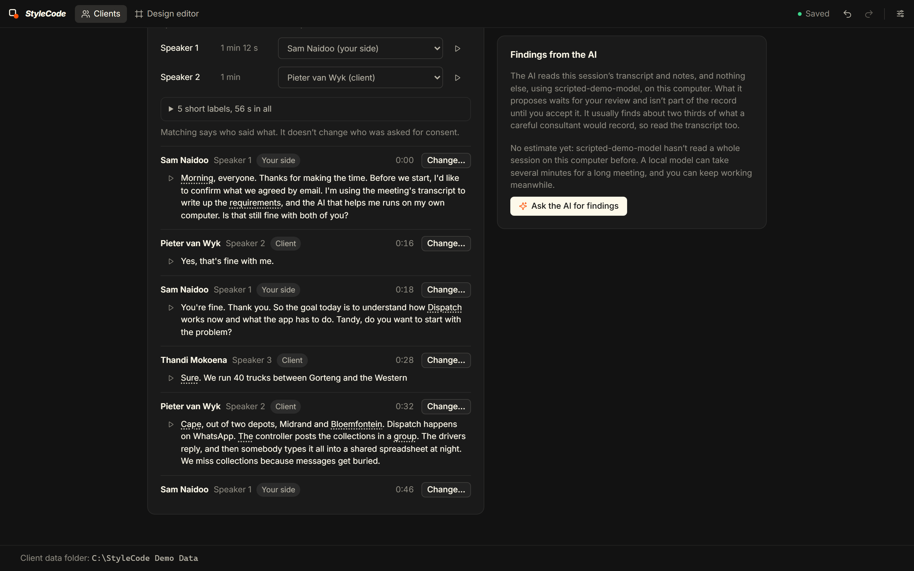
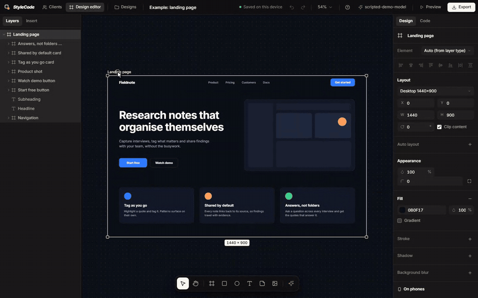
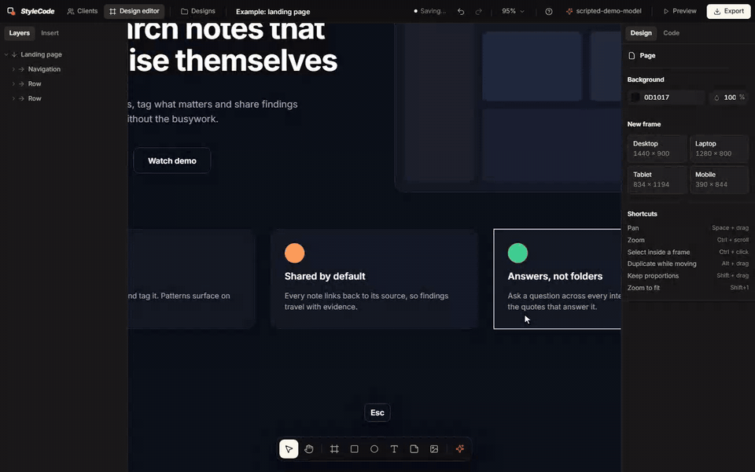

**StyleCode**: a local-first workspace for software consultants. From a client conversation recorded with consent, to a requirements record you've reviewed, to the interface design.
*The canvas is the prompt:* select a layer or pin a note to it, and the AI works on what you point at. *The AI proposes; you decide.*

A consultant's meeting usually becomes scattered notes and a guessed spec. StyleCode turns it into a reviewed record where every requirement traces back to what the client said, and a design whose layers link to those requirements, on the consultant's own computer.

**[Live demo](https://josh-heath123.github.io/StyleCode/app/)** (the editor only, with AI off) · **[Guide](docs/GUIDE.md)** · **[Architecture](docs/ARCHITECTURE.md)** · **[Roadmap](docs/ROADMAP.md)** · [](https://github.com/Josh-Heath123/StyleCode/actions/workflows/ci.yml)

## From conversation to interface

![Five steps from left to right. Step 1, Consent: the consent form, with the client; nothing is captured or sent to an AI without it. Built. Step 2, Capture: record in the room or import a transcript, transcribed on this computer with speakers. Built. Step 3, Record: the AI proposes findings (marked in orange), every quote is checked in code, and you accept, edit or reject each one. Built. Step 4, Design: the canvas inside the engagement, layers linked to findings, and the AI drawing on confirmed findings and saying which (marked in orange). Built. Step 5, Code: HTML and CSS or a React app, compiled from the design the same every time. Built.](docs/media/flow.png)

## A visual tour

The AI in these pictures is a scripted stand-in model, so they can be made again the same way; a real model words and decides things its own way. The clients are role-played.

![A session page: on the right, five findings the AI proposed from Karoo Freight's kick-off, each marked "Proposed by the AI" in orange with its kind and "Suggested (not agreed yet)". The selected one quotes "We miss collections because messages get buried", said by Thandi Mokoena, and offers Accept, Edit and Reject. On the left, the transcript, with that passage highlighted, and a yellow warning above it: Lerato Dlamini, a guest, wasn't asked for consent, so the consultant checks before using what they said.](docs/media/review-proposals.png)

**Review what the AI proposes beside what was said.** Each finding quotes the transcript, the quote is checked before you see it, and nothing joins the record until you accept it. A speaker who wasn't asked for consent is flagged.



**Transcribe on your own computer,** with an NVIDIA graphics card. Match each speaker to a participant, and see which words may be misheard before you rely on them.

![The editor on Harbour Bakery's order page, a cake checkout, with the Pay button and its label selected. On the left, the Record panel lists the engagement's findings in groups (confirmed, assumptions, open); "Customers pay online when they order" and "Orders need two days' notice" each show "1 layer linked". The assistant's proposal, outlined in orange on the canvas, changes the label to "Pay R 450 online and order". Its review panel explains the change, lists under "Drew on:" those two findings, each a link to the record, and says "1 finding left out: the client wasn't told the AI may help sketch the screens." The Record panel still lists that finding, "Cake photos are shown large".](docs/media/canvas-ai-record.png)

**Design with the record beside the canvas, and ask the AI with it in mind.** Link a layer to the findings it answers, and see the link from both sides. On a client's design, the AI is also given the engagement's confirmed findings, statement and kind only, and only those whose sessions' consent allows it. It says which findings it drew on, each a link to the record, and how many it left out and why.


**Mark up a design like a printout.** Pin a note to a layer, ask the AI to do what it says, and accept or reject its proposal with the code in view.



**From a sketch to a layout to code.** <kbd>Shift</kbd>+<kbd>A</kbd> turns a rough drawing into rows and columns that behave like CSS, with the code and a phone preview a click away.



**A note the AI follows.** The proposal appears in orange, and <kbd>Enter</kbd> accepts it as one step you can undo.

## Engineering highlights

- **One design document, changed only through operations.** Every edit, yours or the AI's, is a validated, invertible operation, so undo is exact and code is compiled from the document deterministically. The canvas and the exported code share one mapping to CSS, and a browser test renders the export and checks every box against the canvas to within a pixel. [Architecture §4](docs/ARCHITECTURE.md#4-operations-transactions-and-undo), [`src/model`](src/model), [`e2e/code.spec.ts`](e2e/code.spec.ts).
- **A layout engine that matches the browser.** Auto layout (rows, columns, wrapping, grids, size limits) is resolved by a pure engine in the model. A seeded random browser test lays out 200 nested trees with the engine and with real CSS, and checks they agree to half a pixel, a pixel for text. [`e2e/layout-parity.spec.ts`](e2e/layout-parity.spec.ts), [Architecture §5](docs/ARCHITECTURE.md#parity-with-the-browser).
- **The AI can only propose.** Its reply must fit a schema generated from the property registry; it may touch only what you selected, never locked layers, and its change waits on the canvas until you accept it as one undoable step or reject it. [`src/ai/schema.ts`](src/ai/schema.ts), [Architecture §8](docs/ARCHITECTURE.md#8-ai-collaboration).
- **Consent as code.** Eleven consent rules (C1 to C11) live in a pure, versioned domain model with migrations. They gate every recording, import and AI run in the page. The local servers check consent again before they store a recording or an added WAV and before they start a transcription, and the workspace server refuses any save holding a transcript imported without consent to transcription, audio added without consent to recording, or an AI proposal made where the session's consent didn't allow that AI. AI requests themselves are checked in the page only. [Consent rules](docs/spec/CONSENT.md#rules), [`src/workspace/model`](src/workspace/model).
- **The record as the AI's context, checked against consent.** On a client's design, a pure function chooses the findings the AI may see: confirmed only, statement and kind only, and only where every session a finding rests on allows the AI set up now and the client was told the AI may help sketch the screens. It runs again before every request. The reply names the findings it drew on; an id it wasn't given is ignored and counted, and the AI can't link layers or change the record. [`src/workspace/model/designContext.ts`](src/workspace/model/designContext.ts), [Consent rule C5](docs/spec/CONSENT.md#rules).
- **Extraction whose quotes are checked.** A proposal whose quote isn't in the cited passage is dropped before the consultant sees it. On three short role-played meetings, a small open model run locally (qwen3:4b, on the laptop's GPU) reached 98% precision and 63 to 69% recall over two runs; real meetings will differ. [Extraction: results](docs/research/EXTRACTION.md#results).
- **Transcription on the consultant's own computer.** With an NVIDIA graphics card, the words come from whisper.cpp on the GPU and the speakers from sherpa-onnx on the CPU. Measured on the laptop, on clean audio: 2.4% word errors and 94% of words given the right speaker, with the words alone transcribed at 2.6 minutes per hour of meeting ([recommendation](docs/research/TRANSCRIPTION.md#recommendation)). Through the app, an hour's meeting went from Transcribe to the AI's proposals in 37 minutes ([an hour, through the app](docs/research/TRANSCRIPTION.md#an-hour-through-the-app)). All on synthetic speech, so a lower bound on errors.

## Architecture at a glance

![This computer holds everything but one box. In the browser: one React app with the design editor and the workspace. Local Node servers: the workspace server (checks consent, saves atomically), the AI server (keeps API keys out of the browser) and transcription (one heavy job at a time). Engines on this computer: Ollama, the default for AI, and whisper.cpp for words on the GPU and sherpa-onnx for speakers on the CPU. StyleCode Data: one folder per client, with a lock on the data folder, never inside a git repository, recordings kept only as long as the client agreed. Outside this computer, drawn dashed: an external AI provider, with your own key, only where the session's consent allows.](docs/media/architecture.png)

[ARCHITECTURE.md](docs/ARCHITECTURE.md) explains the design and the reasons behind it.

## Status

| Part | Status |
| --- | --- |
| The editor: drawing, auto layout, code export, the AI on the canvas | Built, v0.5.0 |
| Workspace Phases 0 to 3: clients, consent, notes, the record, transcripts, AI extraction, company knowledge, recording and transcription | Built |
| Workspace Phase 4: designs in the engagement, the record beside the canvas, and the AI drawing on the record | Built |
| Workspace Phase 5: a technology catalogue and a rules engine for architecture | Planned |
| Workspace Phase 6: costs and capacity, computed from sourced, dated prices | Planned |
| Workspace Phase 7: the full specification export, live transcription and follow-up questions | Planned |

The canvas AI is limited by the model. In a role-played live check, qwen3:4b's changes fitted the design in 4 of 16 requests: 3 of 8 with the record, 1 of 8 without. Each time one fitted with the record, it cited findings. That is one run, on role-played data ([the canvas AI with the record: summary](docs/research/CANVAS-AI.md#summary)).

StyleCode isn't used with real clients yet: the consent wording awaits a review under POPIA, South Africa's data protection law, and transcription has been measured on synthetic speech only.

## Quick start

You need [Node.js](https://nodejs.org) 22.12 or newer.

```bash
git clone https://github.com/Josh-Heath123/StyleCode.git
cd StyleCode
npm install
npm start
```

StyleCode opens on your clients at <http://localhost:4173>, with client data in `StyleCode Data` in your home folder. The design editor is under **Design editor** in the top bar. The [guide](docs/GUIDE.md) covers the rest, from [running a consultation](docs/GUIDE.md#running-a-consultation) to [setting up transcription](docs/GUIDE.md#setting-up-transcription).

## Documentation

| Document | What it covers |
| --- | --- |
| [Guide](docs/GUIDE.md) | Using StyleCode: the editor and its [shortcuts](docs/GUIDE.md#shortcuts), [the AI](docs/GUIDE.md#working-with-the-ai), consultations, transcription, [where data lives](docs/GUIDE.md#where-client-data-lives) |
| [Architecture](docs/ARCHITECTURE.md) | How it's built, and why |
| [Roadmap](docs/ROADMAP.md) | Every phase, done and planned, with its acceptance criteria |
| [Vision](docs/vision/PRODUCT-VISION.md) | What StyleCode is for |
| [Decisions](docs/decisions/) | The architecture decision records |
| [Consent](docs/spec/CONSENT.md) and [domain model](docs/spec/DOMAIN-MODEL.md) | The rules the workspace enforces |
| [Research](docs/research/) | Extraction, transcription and the canvas AI, measured on the laptop |
| [Identity](docs/brand/IDENTITY.md) | The look, and the rules it keeps |
| [Contributing](CONTRIBUTING.md) | The code's layout, scripts, tests and how changes are made |

## How it's built

StyleCode is designed and directed by Joshua Heath and implemented with Claude Code from written phase briefs. Each phase is reviewed independently before it's merged; every change is tested (unit tests, browser tests with an accessibility check by axe, and performance budgets for a 5,000-layer document), and every merge is gated by required checks and signed. See [how StyleCode is made](docs/legal/AUTHORSHIP.md), the [decisions](docs/decisions/) and the phase briefs in `docs/phase-*/`.

## Ownership and licence

StyleCode is Copyright © 2026 Joshua Heath ([COPYRIGHT.md](COPYRIGHT.md)), released under the [PolyForm Strict License 1.0.0](LICENSE). In plain words: you may view StyleCode and run it for non-commercial purposes. You may not change it, redistribute it, or use it commercially. The licence text is what counts; this summary only explains it.

Versions up to commit `0fdbdcd` were released under the MIT licence.

- [COPYRIGHT.md](COPYRIGHT.md): who owns StyleCode, and what the licence allows.
- [docs/legal/AUTHORSHIP.md](docs/legal/AUTHORSHIP.md): how StyleCode is made, with which AI tools, and who controls it.
- [THIRD-PARTY-NOTICES.md](THIRD-PARTY-NOTICES.md): the third-party parts, which keep their own licences.
- [TRADEMARKS.md](TRADEMARKS.md): the name and logo.
- [REUSE.toml](REUSE.toml) and [LICENSES/](LICENSES/): the licence and copyright of every file, in the [REUSE](https://reuse.software/spec-3.3/) format.
- [SECURITY.md](SECURITY.md): how to report a vulnerability privately.
- [CONTRIBUTING.md](CONTRIBUTING.md): outside contributions aren't accepted.
