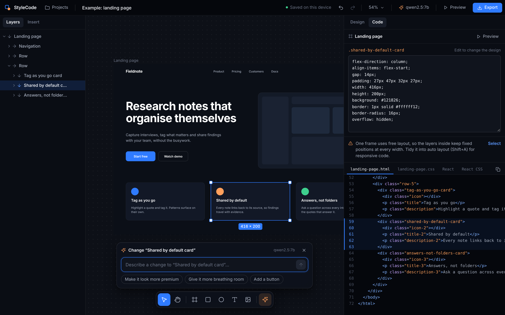

# StyleCode

A local-first visual UI editor where **the canvas is the prompt**. Draw an interface, select part of it and ask an AI to change it, then export it as real HTML/CSS or React. Everything runs on your machine: no account, no cloud service, no hosting costs. AI is optional, and can be a free model on your own computer.



## Why

Prompt-to-UI tools make you describe everything in words. StyleCode lets you *show* instead. The boxes you draw tell the AI which element you mean, where things sit and what contains what, and text is left for intent: "make this feel more premium".

Under the hood, one design document is the single source of truth. Every edit (yours and the AI's) is a small, validated, undoable operation on that document, and code is compiled from it deterministically. The canvas, the code and the preview can never drift apart, and AI changes are targeted and reviewable instead of wholesale rewrites. See [docs/ARCHITECTURE.md](docs/ARCHITECTURE.md) for the full reasoning.

## Status

**Phases 1 to 4 are complete.** The visual editor works on its own, its layouts are built the way real interfaces are, it turns designs into code, and an AI can work on the same design with you:

- **Ask AI** (<kbd>/</kbd>): select part of a design (or nothing, for the whole screen), describe a change, and watch the AI explain what it is doing. Its proposal appears on the canvas in cantaloupe; <kbd>Enter</kbd> accepts it as one undoable step, <kbd>Esc</kbd> rejects it. Suggestions fit what is selected.
- **Your choice of AI**: a free local model with [Ollama](https://ollama.com), any OpenAI-compatible API (OpenAI, LM Studio, OpenRouter, Groq…) or Anthropic, with your own key. Or none: AI is off until you turn it on.
- **Safe by design**: the AI changes the design, never the code, through the same validated operations as your own edits. It only touches what you selected, never locked layers, and asks before deleting a lot. API keys stay on your computer and never reach the browser.

- **Code beside the canvas**: the Code tab shows the selected screen as HTML, CSS and React, with the selected layer's code highlighted. Click a line to select its layer.
- **Edit CSS, change the design**: a layer's CSS is editable in the code panel and flows back into the design, as one undoable step. Anything StyleCode can't represent is reported, not dropped.
- **Exported code matches the canvas**: at the design width the exported page lays out exactly like the canvas (a browser test compares every layer). Below it, rows wrap, fixed widths shrink and large type and spacing scale down, so pages work on phones.
- **Semantic HTML** from roles: `nav`, `button`, `a`, `h1`–`h6`, `ul`/`li`, `input`, `article`, `img`, kept valid (nothing interactive inside a button, only list items in a list).
- **React with components**: each screen is a TypeScript component with a CSS module, and repeated structures (a row of cards) become one component with props for what differs.
- **Preview** the exported page in a sandboxed frame at the design width, tablet and phone widths.
- **Export** a ZIP: a static website (no build step) or a Vite + React + TypeScript app, with images and the Inter font included.
- **Wrapping rows**: rows can wrap onto new lines, like CSS `flex-wrap`.

- Draw frames, rectangles, ellipses, text and images; nest layers inside frames
- Select, multi-select, marquee, move, resize, rotate; drag layers in and out of frames
- **Auto layout**: frames that arrange their children in a row or column with gap, padding, distribution and alignment, and children that are fixed, hug their content or fill the space left. It behaves exactly like CSS flexbox, which a browser test checks.
- **Tidy into auto layout** (<kbd>Shift</kbd>+<kbd>A</kbd>): turns a rough sketch into nested rows and columns, inferring gaps and alignment, without moving things much
- **Smart guides**: moving, resizing and drawing snap to the edges and centres of nearby layers
- **Semantic roles** (button, navigation, card, heading, image, input, link…) so exported code can use the right HTML tags
- Images stored on your device, shadows, gradients and background blur
- **Blocks**: ready-made buttons, badges, text fields, cards, a navigation bar and a hero section, in light or dark, built from auto layout
- Layers panel with rename, hide, lock and drag to reorder or re-parent; it stays fast with thousands of layers
- Properties panel: position, size and sizing, auto layout, role, opacity, radius, fill or gradient, stroke, shadow, blur, typography, image fit, frame presets, align and distribute
- Group/ungroup, duplicate, copy/paste, z-order, context menu, keyboard shortcuts
- Undo/redo for everything
- Pan and zoom with mouse, trackpad or touch (two-finger pinch)
- Projects autosave in your browser; save to and open from `.stylecode.json` files (images included)

Next up: refinement and presentation, including onboarding, an accessibility pass, annotations the AI reads as instructions, and grid layout. See [docs/ROADMAP.md](docs/ROADMAP.md).

## Getting started

You need [Node.js](https://nodejs.org) **22.12 or newer**.

```bash
git clone https://github.com/Josh-Heath123/StyleCode.git
cd StyleCode
npm install
npm run dev
```

Then open <http://localhost:5173>. To try a finished layout, choose **Projects → New example project**. The example is drawn freely; select the *Landing page* frame and press <kbd>Shift</kbd>+<kbd>A</kbd> to watch it become rows and columns, then try editing the headline or dragging one of the cards to a new place in its row. Open the **Code** tab on the right to see the page as HTML, CSS and React, and press **Preview** to see it at phone width.

For a faster, production build:

```bash
npm run build
npm run preview    # serves the build at http://localhost:4173
```

Both `npm run dev` and `npm run preview` include StyleCode's small local AI server. Serving the `dist` folder some other way works too, without AI.

## AI (optional)

StyleCode works fully without AI, and AI is off until you choose a provider. Click the **AI** button in the top bar (or the sparkle at the end of the tool dock).

**Ollama (free, runs on your computer).** Install [Ollama](https://ollama.com), then download a model, for example:

```bash
ollama pull qwen2.5:7b
```

In **AI settings**, choose **Ollama** and press **Test connection**: it lists your installed models. Bigger models follow instructions better; 7–9B models need roughly 5–8 GB of free memory, 3–4B models fit smaller laptops. Raise the **context size** if your designs are large and you have the memory.

**OpenAI-compatible or Anthropic (your own key).** Choose the provider, pick a preset or enter the API address, paste your key, then **Test connection** to choose a model. Local servers such as LM Studio need no key.

**Where keys go.** The key is sent once to StyleCode's local server and saved in `~/.stylecode/ai.json`, readable only by you (set `STYLECODE_AI_CONFIG` to use another file). It is never sent back to the browser, stored in the browser, or written into the project, and it is only ever sent to the API address it was saved with: change the address and you'll be asked for the key again. You can also leave the key out of the settings and set `OPENAI_API_KEY` or `ANTHROPIC_API_KEY` in the environment you start StyleCode from; that key is sent to whichever address you save for that provider.

**Using it.** Select what you want to change and press <kbd>/</kbd>, or click a suggestion. The AI sees the screen you are working on (as a compact list of layers, not a picture) and may change only what you selected, plus new layers inside or next to it. Lock a layer to protect it. While a proposal is on the canvas you can select, pan, zoom and look at its properties and code, but edits wait until you accept or reject it.

| Action | How |
| --- | --- |
| Ask AI | <kbd>/</kbd>, or the sparkle in the tool dock; <kbd>Enter</kbd> sends, <kbd>Shift</kbd>+<kbd>Enter</kbd> for a new line |
| Accept / reject a proposal | <kbd>Enter</kbd> / <kbd>Esc</kbd>, or <kbd>Ctrl</kbd>/<kbd>⌘</kbd>+<kbd>Z</kbd> to reject (a large deletion needs a click to accept) |
| Undo an accepted proposal | <kbd>Ctrl</kbd>/<kbd>⌘</kbd>+<kbd>Z</kbd>, like any edit |
| Stop a request | **Stop** in the assistant |

## Using the editor

| Action | How |
| --- | --- |
| Move / select tool | <kbd>V</kbd> |
| Frame, rectangle, ellipse, text | <kbd>F</kbd>, <kbd>R</kbd>, <kbd>O</kbd>, <kbd>T</kbd> (then drag, or click for a default size) |
| Add an image | <kbd>Ctrl</kbd>+<kbd>Shift</kbd>+<kbd>K</kbd>, or drop or paste image files onto the canvas |
| Add a block | **Insert** tab on the left: click to add to the selected frame, or drag onto the canvas |
| Add auto layout / tidy a frame | <kbd>Shift</kbd>+<kbd>A</kbd> (on a frame: arranges what is inside it; on other layers: wraps them in a row or column) |
| Remove auto layout | <kbd>Alt</kbd>+<kbd>Shift</kbd>+<kbd>A</kbd> |
| Reorder inside auto layout | drag the layer (a line shows where it will land), or use the arrow keys |
| Move without snapping | hold <kbd>Ctrl</kbd>/<kbd>⌘</kbd> while dragging |
| Hand tool / pan | <kbd>H</kbd>, hold <kbd>Space</kbd> and drag, scroll, or two fingers on touch screens |
| Zoom | <kbd>Ctrl</kbd>/<kbd>⌘</kbd> + scroll, pinch, <kbd>Ctrl</kbd>+<kbd>=</kbd> / <kbd>Ctrl</kbd>+<kbd>-</kbd> |
| Zoom to 100% / fit / selection | <kbd>Shift</kbd>+<kbd>0</kbd> / <kbd>Shift</kbd>+<kbd>1</kbd> / <kbd>Shift</kbd>+<kbd>2</kbd> |
| Select inside a frame | <kbd>Ctrl</kbd>/<kbd>⌘</kbd> + click; select a top-level frame by its name label |
| Add to selection | <kbd>Shift</kbd> + click, or drag a marquee |
| Keep proportions / resize from centre | hold <kbd>Shift</kbd> / <kbd>Alt</kbd> while resizing |
| Snap rotation to 15° | hold <kbd>Shift</kbd> while rotating |
| Duplicate while moving | hold <kbd>Alt</kbd> while dragging |
| Edit text | double-click it, or select it and press <kbd>Enter</kbd> |
| Select parent / children | <kbd>Esc</kbd> or <kbd>Shift</kbd>+<kbd>Enter</kbd> / <kbd>Enter</kbd> |
| Nudge | arrow keys (<kbd>Shift</kbd> for 10px); inside auto layout they move the layer one place |
| Undo / redo | <kbd>Ctrl</kbd>+<kbd>Z</kbd> / <kbd>Ctrl</kbd>+<kbd>Y</kbd> (<kbd>⌘</kbd>+<kbd>Z</kbd> / <kbd>⇧</kbd><kbd>⌘</kbd>+<kbd>Z</kbd>) |
| Duplicate, group, ungroup | <kbd>Ctrl</kbd>+<kbd>D</kbd>, <kbd>Ctrl</kbd>+<kbd>G</kbd>, <kbd>Ctrl</kbd>+<kbd>Shift</kbd>+<kbd>G</kbd> |
| Bring forward / to front | <kbd>Ctrl</kbd>+<kbd>]</kbd> / <kbd>Ctrl</kbd>+<kbd>Shift</kbd>+<kbd>]</kbd> |
| Lock / hide | <kbd>Ctrl</kbd>+<kbd>Shift</kbd>+<kbd>L</kbd> / <kbd>Ctrl</kbd>+<kbd>Shift</kbd>+<kbd>H</kbd> |
| Align | buttons in the properties panel, or <kbd>Alt</kbd>+<kbd>A</kbd>/<kbd>D</kbd>/<kbd>W</kbd>/<kbd>S</kbd>/<kbd>H</kbd>/<kbd>V</kbd> |

Number fields accept arithmetic (`1440/3`), step with the arrow keys and can be scrubbed by dragging their label.

### Code and export

Each top-level frame is a **screen**: one page of the exported site, or one component of the React app.

| Action | How |
| --- | --- |
| See a screen's code | **Code** tab on the right; select a layer to highlight its code, or click a line to select its layer |
| Change a layer through CSS | edit its CSS at the top of the Code tab, then <kbd>Ctrl</kbd>/<kbd>⌘</kbd>+<kbd>Enter</kbd> (<kbd>Esc</kbd> cancels) |
| Copy a file | the copy button beside the file tabs |
| Preview the page | **Preview** in the top bar: design width, tablet (768px) and phone (390px) |
| Export | **Export** in the top bar: a website (HTML and CSS) or a React app (Vite + TypeScript), as a ZIP |

Layouts in auto layout export as flexbox and adapt to smaller screens; layers in free layout keep fixed positions, and the Code tab says so. Selecting the screen and pressing <kbd>Shift</kbd>+<kbd>A</kbd> fixes that.

## Your data

Projects are stored in your browser's IndexedDB on this device and autosave as you work. Images you add are stored there too, once each however many times you use them; nothing is uploaded anywhere. Use **Projects → Save to file…** to keep a portable copy or move a project between browsers (the images used in the project are embedded in the file), and **Open project file…** to bring one back. Clearing your browser's site data for `localhost` deletes locally stored projects, so save important work to a file. Code export and the preview also run entirely on your machine.

With AI on, each request sends a text description of the screen you are working on (layer names, text and properties, but not images) to the provider you chose. With Ollama on your own computer, nothing leaves it. AI settings and keys are kept in `~/.stylecode/ai.json`, not in the browser.

## Project structure

```
src/
  model/        design document, property registry, operations, geometry, commands,
                auto-layout engine and inference, file format (pure TS, fully tested)
  ai/           the assistant: context builder, instructions, response schema,
                interpretation and AI policy, suggestions, local server client
  editor/       editor store, history, camera, React bindings
  render/       the single design → CSS mapping shared by the canvas and code export
  codegen/      HTML/CSS and React generators, CSS → design parser, site and app export, ZIP (pure TS, tested)
  canvas/       viewport, layer rendering, selection overlay, gestures, snapping, text measurement
  panels/       layers, insert, properties and code panels
  persistence/  IndexedDB storage, image assets, project files, example project
  app/          app shell, top bar, tool dock, assistant bar, AI settings, shortcuts,
                actions, blocks, preview and export
  ui/           icons and menus
server/ai/      the local AI server (a Vite plugin): settings and keys, providers, streaming
e2e/            browser tests (Playwright), including layout parity, export fidelity
                and the AI flow against a fake Ollama
docs/           architecture and roadmap
```

## Scripts

| Script | What it does |
| --- | --- |
| `npm run dev` | Start the development server |
| `npm run build` | Type-check and build for production |
| `npm run preview` | Serve the production build |
| `npm test` | Run the unit tests |
| `npm run test:e2e` | Run the browser tests (starts its own dev server on port 5174, with AI settings in a temporary file) |
| `npm run test:all` | Unit tests, then browser tests |
| `npm run typecheck` | Type-check the app and the browser tests |

The browser tests need Playwright's Chromium once per machine: `npx playwright install chromium`.

## Tech

React 19 and TypeScript, built with Vite. The canvas renders layers as real DOM elements, so the canvas shows exactly what the exported CSS will render. Runtime dependencies are React, React DOM and the Inter font, and nothing else; the AI server uses only Node's standard library (`fetch`, `http`, `fs`), and tests use Vitest and Playwright.
