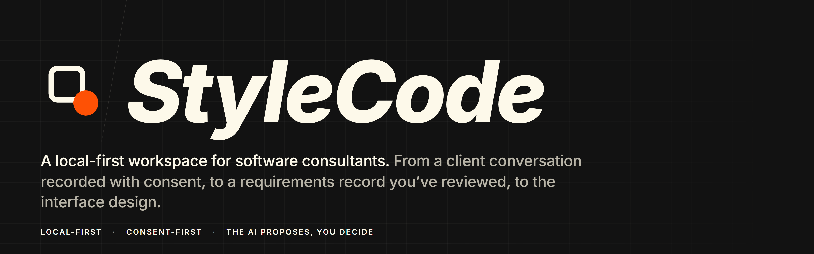

**StyleCode**: a local-first workspace for software consultants. From a client conversation recorded with consent, to a requirements record you've reviewed, to the interface design.
*The canvas is the prompt. The AI proposes; you decide.*

A consultant's meeting usually becomes scattered notes and a guessed spec. StyleCode turns it into a reviewed record where every requirement traces back to what the client said, and a design whose layers link to those requirements, all on the consultant's own computer.

**[Live demo](https://josh-heath123.github.io/StyleCode/app/)** (the editor only, with AI off) · **[Guide](docs/GUIDE.md)** · **[Architecture](docs/ARCHITECTURE.md)** · **[Roadmap](docs/ROADMAP.md)** · [](https://github.com/Josh-Heath123/StyleCode/actions/workflows/ci.yml)

## From conversation to interface

*Draft: this becomes one rendered diagram in WP5.*

1. **Consent** (built): a consent form for each session, shown to the client. Nothing is recorded, imported or sent to an AI without it.
2. **Capture** (built): record the meeting in the room, add a WAV, or import the transcript Teams, Zoom or Google Meet made. Recordings are transcribed on this computer, with who spoke when.
3. **Record** (built): the AI proposes findings from the transcript, every quote is checked in code before you see it, and you accept, edit or reject each one.
4. **Design** (in progress): the StyleCode editor inside the engagement, with layers linked to findings.
5. **Code** (built): the design exported as HTML/CSS or a React app.

## A visual tour

*Draft: the four screenshots and two GIFs are recorded in WP5, in the new look.*

## Engineering highlights

- **One design document, changed only through operations.** Every edit, yours or the AI's, is a validated, invertible operation, so undo is exact and code is compiled from the document deterministically: the canvas, the code and the preview can't drift apart. [Architecture §3–4](docs/ARCHITECTURE.md#4-operations-transactions-and-undo), [`src/model`](src/model).
- **A layout engine that matches the browser.** Auto layout (rows, columns, wrapping, grids, size limits) is resolved by a pure engine in the model, and a randomised browser test lays out random nested trees with the engine and with real CSS and checks they agree to half a pixel. [`e2e/layout-parity.spec.ts`](e2e/layout-parity.spec.ts), [Architecture §5](docs/ARCHITECTURE.md#parity-with-the-browser).
- **The AI can only propose.** Its reply must fit a schema generated from the property registry; it may touch only what you selected, never locked layers, and its change appears on the canvas in orange until you accept it as one undoable step or reject it. [`src/ai/schema.ts`](src/ai/schema.ts), [Architecture §8](docs/ARCHITECTURE.md#8-ai-collaboration).
- **Consent as code.** Rules C1 to C11 live in a pure, versioned domain model with migrations, and gate every recording, import and AI run, in the page and again on the server. [`docs/spec/CONSENT.md`](docs/spec/CONSENT.md#rules), [`src/workspace/model`](src/workspace/model).
- **Extraction whose quotes are checked.** A proposal whose quote isn't in the cited passage is dropped before the consultant sees it. On three short role-played meetings, qwen3:4b on the laptop's GPU reached 98% precision and 69% recall; real meetings will differ. [Extraction: results](docs/research/EXTRACTION.md#results).
- **Transcription on the consultant's own GPU.** whisper.cpp and sherpa-onnx, measured on the laptop at 2.6 minutes per hour of meeting, 2.4% word errors and 94% of words given the right speaker, on synthetic speech, so a lower bound on errors. [Transcription: recommendation](docs/research/TRANSCRIPTION.md#recommendation).

## Architecture at a glance

*Draft: this becomes one rendered diagram in WP5.*

- **In the browser:** the editor and the workspace, one React app.
- **On this computer, as local Node servers:** the workspace server (one folder per client, atomic saves, a lock on the data folder), the AI server (keys stay here, never in the browser) and transcription (whisper.cpp, sherpa-onnx).
- **AI:** Ollama on this computer by default; an external provider with your own key only where the session's consent allows it.

See [ARCHITECTURE.md](docs/ARCHITECTURE.md) for the design and the reasons behind it.

## Status

| Part | Status |
| --- | --- |
| The editor: drawing, auto layout, code export, the AI on the canvas | Built, v0.5.0 |
| Workspace Phases 0 to 3: clients, consent, notes, the record, transcripts, AI extraction, company knowledge, recording and transcription | Built |
| Workspace Phase 4: designs in the engagement and the record beside the canvas | Built |
| Workspace Phase 4: the AI drawing on the record | Next |
| Phase 5: a technology catalogue and a rules engine for architecture | Planned |
| Phase 6: costs and capacity, computed from sourced, dated prices | Planned |
| Phase 7: the full specification export, live transcription and follow-up questions | Planned |

StyleCode isn't used with real clients yet: the consent wording awaits a POPIA review, and transcription has been measured on synthetic speech only.

## Quick start

You need [Node.js](https://nodejs.org) 22.12 or newer.

```bash
git clone https://github.com/Josh-Heath123/StyleCode.git
cd StyleCode
npm install
npm start
```

StyleCode opens on your clients at <http://localhost:4173>, with client data in `StyleCode Data` in your home folder. The design editor is under **Design editor** in the top bar. The [guide](docs/GUIDE.md) covers the rest, from [running a consultation](docs/GUIDE.md#running-a-consultation) to [setting up transcription](docs/GUIDE.md#setting-up-transcription).

## Documentation

| Document | What it covers |
| --- | --- |
| [Guide](docs/GUIDE.md) | Using StyleCode: the editor, the AI, consultations, transcription, where data lives |
| [Architecture](docs/ARCHITECTURE.md) | How it's built, and why |
| [Roadmap](docs/ROADMAP.md) | Every phase, done and planned, with its acceptance criteria |
| [Vision](docs/vision/PRODUCT-VISION.md) | What StyleCode is for |
| [Decisions](docs/decisions/) | The architecture decision records |
| [Consent](docs/spec/CONSENT.md) and [domain model](docs/spec/DOMAIN-MODEL.md) | The rules the workspace enforces |
| [Research](docs/research/) | Extraction and transcription, measured on the laptop |
| [Identity](docs/brand/IDENTITY.md) | The look, and the rules it keeps |
| [Contributing](CONTRIBUTING.md) | How StyleCode is worked on and tested |

## How it's built

StyleCode is designed and directed by Joshua Heath and implemented with Claude Code from written phase briefs. Each phase is reviewed independently before it's merged; every change is tested (unit tests, browser tests with an accessibility check by axe, and performance budgets for a 5,000-layer document), and every merge is gated by required checks and signed. See [how StyleCode is made](docs/legal/AUTHORSHIP.md), the [decisions](docs/decisions/) and the phase briefs in `docs/phase-*/`.

## Ownership and licence

StyleCode is Copyright © 2026 Joshua Heath ([COPYRIGHT.md](COPYRIGHT.md)), released under the [PolyForm Strict License 1.0.0](LICENSE). In plain words: you may view StyleCode and run it for non-commercial purposes. You may not change it, redistribute it, or use it commercially. The licence text is what counts; this summary only explains it.

Versions up to commit `0fdbdcd` were released under the MIT licence.

- [COPYRIGHT.md](COPYRIGHT.md): who owns StyleCode, and what the licence allows.
- [docs/legal/AUTHORSHIP.md](docs/legal/AUTHORSHIP.md): how StyleCode is made, with which AI tools, and who controls it.
- [THIRD-PARTY-NOTICES.md](THIRD-PARTY-NOTICES.md): the third-party parts, which keep their own licences.
- [TRADEMARKS.md](TRADEMARKS.md): the name and logo.
- [REUSE.toml](REUSE.toml) and [LICENSES/](LICENSES/): the licence and copyright of every file, in the [REUSE](https://reuse.software/spec-3.3/) format.
- [SECURITY.md](SECURITY.md): how to report a vulnerability privately.
- [CONTRIBUTING.md](CONTRIBUTING.md): outside contributions aren't accepted.
